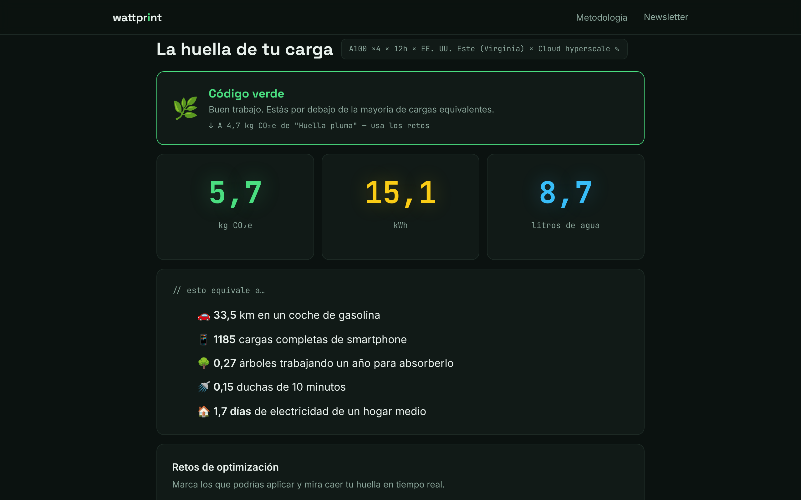

# Wattprint

**¿Cuánto carbono, energía y agua consume tu IA?** Wattprint lo calcula en un minuto para un entrenamiento, un ajuste fino o un servicio de inferencia, también por petición. Sin registro y sin enviar datos a ningún servidor: todo se calcula en tu navegador. En español e inglés.

**Pruébala:** https://wattprint-kappa.vercel.app/ · [English version](https://wattprint-kappa.vercel.app/?lang=en)



## Qué hace

1. Eliges el tipo de carga, la GPU, cuántas unidades y cuántas horas, la región y el tipo de centro de datos. Si ya has medido el consumo (CodeCarbon, nvidia-smi, DCGM), puedes meter los kWh medidos en vez de estimarlos.
2. Te da los kg de CO₂e, los kWh y los litros de agua, con un desglose visual de dónde sale cada cifra:
   - carbono de la electricidad y de la fabricación del hardware;
   - energía de los servidores y consumo extra del centro de datos (PUE);
   - agua de refrigeración y agua usada para generar la electricidad.
3. Si es un servicio de inferencia, calcula la huella **por petición** (la unidad funcional R de SCI). Si se repite, da la **vista anual**.
4. Propone retos de optimización (región más limpia, cloud hyperscale, ajuste de capacidad, cuantización, planificación según la red) y recalcula al momento, incluidos los efectos contrarios: pasar a una red con mucha hidráulica baja el carbono pero sube el agua.
5. Exporta un **informe en PDF** (con las hipótesis y las fuentes, pensado para pasárselo a dirección o al área de sostenibilidad), los **datos en CSV**, una tarjeta para redes y un enlace con el resultado.

## Cómo calcula

Marco: especificación **Software Carbon Intensity (SCI)** de la Green Software Foundation, publicada como **ISO/IEC 21031:2024**: `SCI = ((E × I) + M) por R`.

| Magnitud | Fórmula | Fuente de los datos |
|---|---|---|
| Energía (E) | `kWh = TDP × unidades × horas × utilización ÷ 1000 × PUE`, o kWh medidos × PUE | TDP del fabricante (NVIDIA). PUE: media del sector 1,54 (Uptime Institute, 2025); grandes nubes 1,13 (Google 1,09 y Microsoft 1,17, 2025) |
| Carbono (I) | `kg CO₂e = kWh × intensidad de la red ÷ 1000` | Intensidad de ciclo de vida por país de [Ember](https://ember-energy.org/data/yearly-electricity-data/) (CC BY 4.0), vía [Our World in Data](https://github.com/owid/energy-data); estados de EE. UU. de [Ember US Electricity Data](https://ember-energy.org/data/us-electricity-data/). Método location-based |
| Fabricación (M) | ≈300 kg CO₂e por acelerador ÷ vida útil (4–6 años) | Luccioni et al. (2022); Semiconductor Climate Consortium (2025) |
| Agua de refrigeración | `litros = kWh de servidores × WUE` | Media del sector ≈1,9 L/kWh (EESI, 2025); grandes nubes 0,27 L/kWh (Microsoft, año fiscal 2025; AWS informa 0,12) |
| Agua de generación eléctrica | `litros = kWh totales × factor de agua de la red` | [WRI, Reig et al. (2020)](https://www.wri.org/research/guidance-calculating-water-use-embedded-purchased-electricity), factores de consumo por país; mismo marco que [Li et al., *Making AI Less "Thirsty"*](https://arxiv.org/abs/2304.03271) |

Equivalencias de la calculadora de la EPA de EE. UU. y ducha media de la Water Research Foundation (2016).

**Límites y referencias.** No existe ninguna norma que limite la huella de una carga de IA. Las medallas de la herramienta son una escala orientativa propia. Como referencia legal real se muestra el PUE frente a la ley de eficiencia energética de Alemania (EnEfG: ≤ 1,5 desde 2027 y ≤ 1,3 desde 2030 para centros existentes, ≤ 1,2 para nuevos). La etiqueta europea de centros de datos (A–G, por PUE y WUE) se añadirá cuando se publiquen sus umbrales.

Son **estimaciones de orden de magnitud, no una medición certificada**. La metodología completa y la tabla de factores por región están dentro de la herramienta, en «Metodología».

## Datos siempre al día

La intensidad de carbono se actualiza sola. Una GitHub Action ([`update-data.yml`](.github/workflows/update-data.yml)) ejecuta [`scripts/update-data.mjs`](scripts/update-data.mjs) el día 2 de cada mes: descarga los últimos datos de Ember, comprueba que los valores son plausibles, actualiza `index.html` y guarda el cambio con la fecha. Si una fuente falla, se conservan los valores anteriores. También se puede lanzar a mano desde la pestaña *Actions*.

Los factores de agua de la electricidad (WRI, 2020) y los valores de PUE y WUE no tienen una publicación periódica en formato abierto; se revisan a mano cuando sale una edición nueva.

## Cómo usarla en local

Es un único archivo HTML sin dependencias ni proceso de compilación:

```bash
git clone https://github.com/KairlosGG/wattprint.git
cd wattprint
python3 -m http.server 8000   # o abre index.html directamente
```

Los datos (regiones, PUE, WUE, factores de agua, equivalencias) están en el objeto `DATA` de `index.html`, en un solo sitio, para que sea fácil revisarlos o actualizarlos. Los textos en los dos idiomas están en `I18N`.

## Licencias y créditos

- Código: [MIT](LICENSE) © 2026 Carlos Gallego Galán.
- Datos de intensidad de carbono: Ember, CC BY 4.0.
- Factores de agua de la electricidad: World Resources Institute (2020).
- Tipografías Space Grotesk, Inter y JetBrains Mono: SIL Open Font License 1.1.
- Proyecto independiente, sin relación con la Green Software Foundation, Ember, WRI ni los proveedores citados.

Hecha por [Carlos Gallego Galán](https://neocortech-kohl.vercel.app/). Escribo sobre gobernanza de IA en la newsletter [Neocortech](https://neocortech-kohl.vercel.app/newsletter).

---

## English

**How much carbon, energy and water does your AI use?** Wattprint estimates it in about a minute for a training run, a fine-tune or an inference service, per request too. No sign-up, nothing is sent to a server: everything runs in your browser.

- **Try it:** https://wattprint-kappa.vercel.app/?lang=en
- **Method:** Software Carbon Intensity (SCI, ISO/IEC 21031). Energy from GPU TDP and utilisation, or your measured kWh, times PUE. Carbon from Ember grid intensity (location-based) plus amortised embodied emissions. Water = cooling (WUE) + electricity generation (WRI country factors, as in Li et al.).
- **Outputs:** visual breakdown, per-request (SCI functional unit) and annual views, optimisation challenges, PDF report, CSV data, share card and link.
- **Limits:** order-of-magnitude estimates, not certified measurement.
- **Run locally:** a single HTML file; serve the folder with any static server.
- **License:** MIT for the code; Ember data under CC BY 4.0; fonts under SIL OFL 1.1.
